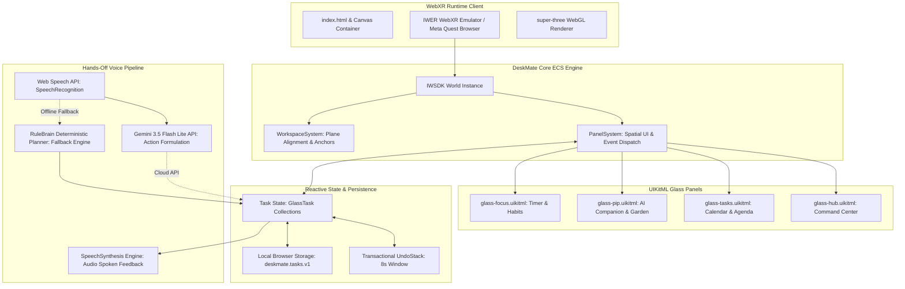
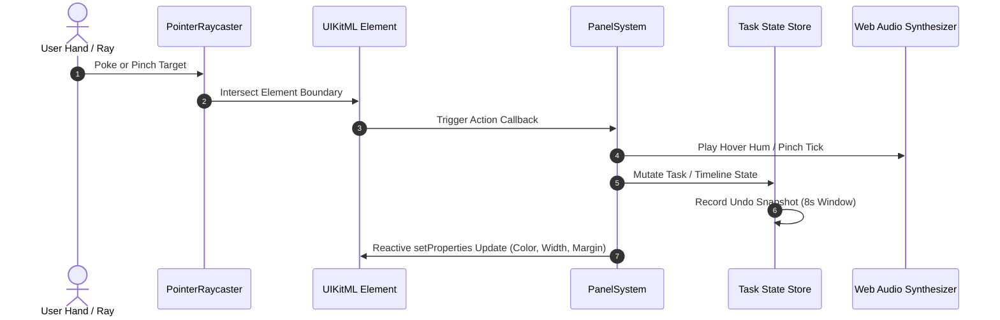
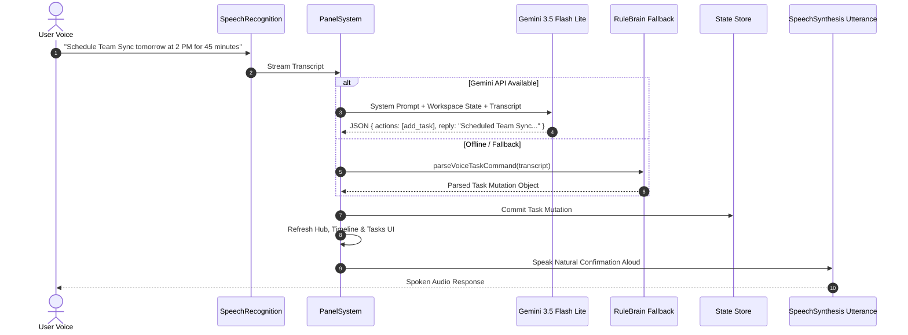

# DeskMate — Mixed-Reality Spatial Productivity Workspace

[](./LICENSE)
[](https://www.meta.com/quest/)
[](https://iwsdk.dev/)
[-success.svg)](./tests)
[](./tests/brain-golden.test.ts)

> **The Premier Spatial Productivity Workstation in Mixed Reality**  
> Built for Meta Quest 3 and WebXR platforms. Engineered with a **Dual-Mode Interaction Model**: **100% Hands-First Direct Physical Manipulation** coupled with a frictionless **Hands-Off Ambient Voice & Autonomous Companion System**.

---

## 📑 Table of Contents

1. [Executive Summary & Product Vision](#-executive-summary--product-vision)
2. [Dual-Mode Architecture: Hands-First & Hands-Off](#-dual-mode-architecture-hands-first--hands-off)
   - [Hands-First Architecture: Direct Spatial Manipulation](#1-hands-first-architecture-direct-spatial-manipulation)
   - [Hands-Off Architecture: Ambient Voice & Autonomous Action](#2-hands-off-architecture-ambient-voice--autonomous-action)
3. [System Architecture & Data Flow](#-system-architecture--data-flow)
   - [Architectural Topology Diagram](#architectural-topology-diagram)
   - [Hands-First Spatial Interaction Pipeline](#hands-first-spatial-interaction-pipeline)
   - [Hands-Off Voice Action Pipeline](#hands-off-voice-action-pipeline)
4. [In-Depth Feature Catalog (All Modules)](#-in-depth-feature-catalog-all-modules)
   - [1. Spatial Glass Command Center (Central Hub)](#1-spatial-glass-command-center-central-hub)
   - [2. Interactive Tasks & Multi-Week Calendar Navigation](#2-interactive-tasks--multi-week-calendar-navigation)
   - [3. Focus Sprint Studio & Pomodoro Timer](#3-focus-sprint-studio--pomodoro-timer)
   - [4. Today's Schedule & 15-Minute Snapping Timeline Track](#4-todays-schedule--15-minute-snapping-timeline-track)
   - [5. Workload Capacity Donut & Cognitive Load Analyzer](#5-workload-capacity-donut--cognitive-load-analyzer)
   - [6. Pip 3D Robot Companion & Productivity Garden](#6-pip-3d-robot-companion--productivity-garden)
   - [7. In-Place Task Editor & Priority Matrix](#7-in-place-task-editor--priority-matrix)
   - [8. Spatial Desk Ruler & Tabletop Physics](#8-spatial-desk-ruler--tabletop-physics)
   - [9. Dual Active Ray Pointers & Reticle Indicators](#9-dual-active-ray-pointers--reticle-indicators)
   - [10. Multi-Day Task Distribution & Cross-Day Scheduling](#10-multi-day-task-distribution--cross-day-scheduling)
   - [11. Multi-Step Undo Engine & Transaction Reversibility](#11-multi-step-undo-engine--transaction-reversibility)
   - [12. Ambient Procedural Co-Working Audio (Ghost Deskmate)](#12-ambient-procedural-co-working-audio-ghost-deskmate)
5. [Resilience & Tab-Switching Architecture](#-resilience--tab-switching-architecture)
6. [Technical Stack & Design Decisions](#-technical-stack--design-decisions)
7. [Automated Testing & Golden Verification Suites](#-automated-testing--golden-verification-suites)
8. [Installation & Development Guide](#-installation--development-guide)
9. [Deployment & Production PWA Packaging](#-deployment--production-pwa-packaging)
10. [License](#-license)

---

## 🌟 Executive Summary & Product Vision

**DeskMate** transforms any real-world desk or tabletop into a calm, focused, and aesthetically cohesive spatial productivity operating system in Mixed Reality.

Traditional VR interfaces frequently suffer from two core failure modes:
1. **Controller Dependence:** Requiring physical controllers that clutter the desk and force users to put down physical pens, notebooks, or coffee cups.
2. **Virtual Keyboard Fatigue:** Attempting to replicate desktop keyboards in 3D air, leading to slow typing, high error rates, modal dialog freezes, and broken mental flow.

DeskMate solves both challenges through a **Dual-Mode Ergonomic Philosophy**:

```
+-----------------------------------------------------------------------------+
|                            DESKMATE WORKSPACE                               |
|                                                                             |
|      [HANDS-FIRST]                             [HANDS-OFF]                  |
|   Direct Physical Spatial Touch            Ambient Voice & Autonomy         |
|   - Tabletop physical ruler                - Natural Gemini 3.5 voice AI    |
|   - 15-minute magnetic snapping            - Multi-action execution         |
|   - Spatial panel dragging                 - Autonomous Pip companion       |
|   - Zero virtual keyboard typing           - Proactive schedule packing     |
|   - Visual dual-pointer rays               - Ambient co-working audio       |
+-----------------------------------------------------------------------------+
```

When users wish to touch and arrange their workspace, **Hands-First** provides instant, haptic-feeling direct spatial interactions. When users are deep in physical deep work or note-taking, **Hands-Off** allows complete voice-driven agenda planning, task completion, schedule adjustments, and timer manipulation without lifting a finger.

---

## 🖐️ Dual-Mode Architecture: Hands-First & Hands-Off

### 1. Hands-First Architecture: Direct Spatial Manipulation

DeskMate’s Hands-First system is built upon **zero-controller direct manipulation**. The platform runs entirely via WebXR Hand Tracking:

- **Seated Reach Envelope ($\le 0.65$m Radius):** Every interactive button, panel handle, task row, and slider is positioned within comfortable seated reach without requiring torso leaning or standing.
- **Physical Desk Alignment (WebXR Plane Detection):** Scans the room for horizontal tabletop planes (`table`, `desk`). When entering XR passthrough, the virtual wooden table mesh automatically hides, making the user's real physical desk their actual work surface.
- **Magnetic Snapping (15-Minute Grid):** Task tiles and schedule blocks snap magnetically to 15-minute intervals ($09:00, 09:15, 09:30, \dots$) with subtle audio tick feedback and translucent preview landing ghosts.
- **Dual Visual Pointer Beams & Reticles:** Both left and right hands project soft laser guide beams (Cylinder geometry with 8-segment tessellation) terminating in clean circular reticle rings on glass panels, enabling simultaneous dual-hand interaction.
- **Spatial Panel Dragging & Billboard Yaw:** Users can grab any glass panel by its top handle bar to freely reposition it in 3D space. As panels move, they smoothly billboard their yaw angle toward the user’s eyes for optimal legibility.

### 2. Hands-Off Architecture: Ambient Voice & Autonomous Action

The Hands-Off architecture eliminates the need to look up or touch screens during deep focus sprints:

- **Multimodal Gemini 3.5 Flash Lite Assistant:** Integrated with the Gemini API to interpret conversational voice commands into structured JSON action mutations (`add_task`, `delete_task`, `edit_task`, `complete_task`, `start_focus_timer`, `plan_day`, `navigate_view`).
- **Autonomous Pip 3D Robot Avatar:** Positioned directly beside the Command Center with a 60fps physical bobbing animation, counter-rotating metallic rings, and emotive state transitions (*thinking*, *celebrating*, *encouraging*).
- **Proactive Day Planning ("Plan My Day"):** Automatically sorts unscheduled tasks by priority and duration, packing them contiguously into working hours ($08:00\text{--}18:00$) with mandatory 10-minute restorative buffers.
- **Conflict & Overlap Healing ("Fix Overlaps"):** Analyzes the timeline in real time; when overlapping tasks are detected, conflicting items are automatically pushed to the nearest free time slot.
- **Natural Spoken Feedback (TTS):** Responses are delivered through the browser Speech Synthesis API using natural, high-clarity human-like voices, confirming actions aloud without requiring visual verification.
- **Deterministic Offline Fallback:** If offline or if cloud APIs are unreachable, DeskMate seamlessly switches to its local deterministic regex parser and RuleBrain engine without dropping user commands.

---

## 🏛️ System Architecture & Data Flow

### Architectural Topology Diagram



### Hands-First Spatial Interaction Pipeline



### Hands-Off Voice Action Pipeline



---

## 📦 In-Depth Feature Catalog (All Modules)

### 1. Spatial Glass Command Center (Central Hub)
- **Architectural Dimensions:** $780\text{px} \times 720\text{px}$ curved translucent glass panel with $24\text{px}$ border radius and subtle specular borders (`rgba(255, 255, 255, 0.18)`).
- **Navigation Tabs:** Overview, Schedule, Notes, and Goals subviews with instantaneous in-place switching.
- **Dynamic Header:** Displays live digital clock, formatted calendar date, anonymous personalized greetings based on time of day, and workload summary metrics.
- **Unified Section Zoom:** Any widget card can be zoomed in-place to occupy the primary viewing area, with an instant "Back to Overview" pill button.

### 2. Interactive Tasks & Multi-Week Calendar Navigation
- **Multi-Week Date Strip:** 7-day responsive calendar picker ($16\text{th}\text{--}22\text{nd}$ dates) with dedicated navigation buttons ($\ll, \gg$) and active date highlighting.
- **Task Filtering:** Instant 1-tap categorization by priority (*All*, *High*, *Med*, *Low*).
- **Task Row Metrics:** Each task displays a priority accent bar, completion checkbox with checkmark animations, task title with automatic text truncation, and quick inline Edit (`Ed`) and Delete (`Del`) buttons.
- **Strict Boundary Containment:** Container overflow protection (`overflow: hidden`) ensures task buttons never bleed into neighboring widgets.

### 3. Focus Sprint Studio & Pomodoro Timer
- **Ring Visualization:** Mathematical progress ring displaying remaining sprint time with dynamic color shifts.
- **Quick Preset Chips:** Instant sprint duration chips ($5\text{m}, 15\text{m}, 25\text{m}, 45\text{m}, 60\text{m}$).
- **Fine-Grained Adjustments:** Incremental $\pm 1\text{m}$ and $\pm 5\text{m}$ steppers for precise session tuning.
- **Sprint Modes:** Seamless toggling between *Focus Sprint*, *Short Break* ($5\text{m}$), and *Long Break* ($15\text{m}$).
- **Completion Rewards:** Completing a sprint awards $+30\text{ XP}$ to the Productivity Garden and triggers Pip’s celebratory dance.

### 4. Today's Schedule & 15-Minute Snapping Timeline Track
- **10-Hour Timeline Axis:** Accurately graduated axis spanning $08:00\text{ to }18:00$ with 11 clear hourly ticks ($8\text{ AM}, 9\text{ AM}, 10\text{ AM}, 11\text{ AM}, 12\text{ PM}, 1\text{ PM}, 2\text{ PM}, 3\text{ PM}, 4\text{ PM}, 5\text{ PM}, 6\text{ PM}$).
- **Dynamic Proportional Positioning:** Each scheduled task block is calculated relative to the total workday duration ($600\text{ minutes}$):
  $$\text{relativeLeftPercent} = \frac{\text{startMinute} - 480}{600} \times 100$$
  $$\text{widthPercent} = \max\left(4.5, \frac{\text{duration}}{600} \times 100\right)$$
- **Real-Time Sun "Now" Marker:** An animated purple badge indicating the exact current time of day, positioned dynamically along the timeline track.
- **Direct Block Interaction:** Touching any schedule block triggers the in-place editor, allowing start time and duration adjustments on the fly.

### 5. Workload Capacity Donut & Cognitive Load Analyzer
- **Multi-Segment Capacity Ring:** Visualizes the distribution of scheduled hours versus available daily capacity ($480\text{ minutes / 8 hours}$).
- **Capacity Metric Calculation:**
  $$\text{capacityPercentage} = \text{round}\left(\frac{\sum \text{scheduledMinutes}}{\text{dailyCapacityMinutes}} \times 100\right)$$
- **Cognitive Overload Warning:** Automatically detects when scheduled work exceeds 100% capacity and displays visual warning badges with recommendations to reschedule non-critical items.

### 6. Pip 3D Robot Companion & Productivity Garden
- **Procedural 3D Robot Mesh:**
  - Torso sphere and hovering head with continuous $60\text{fps}$ sinusoidal bobbing.
  - Dual counter-rotating metallic gimbal rings ($0.8\text{ rad/s}$ outer ring, $-1.1\text{ rad/s}$ inner ring).
  - Glowing emissive cyan eye visor.
- **Reactive Emotional States:**
  - `idle`: Calm breathing movement.
  - `thinking`: Antenna tilt and accelerated ring rotation during voice processing.
  - `celebrate`: Joyful vertical hops and high-speed counter-rotation upon task completion.
- **Productivity Garden:** Gamified progression track awarding XP for completed sprints and tasks, advancing through developmental milestones (*Sprout*, *Seedling*, *Flowering Plant*, *Productivity Tree*).

### 7. In-Place Task Editor & Priority Matrix
- **Zero-Modal Architecture:** The editor expands seamlessly within the Command Center, avoiding detached floating dialogs.
- **Duration Sliders & Steppers:** Real-time visual steppers with $\pm 5\text{m}$ and $\pm 15\text{m}$ increments.
- **Priority Matrix:** 3-state selector (*High* in crimson, *Medium* in amber, *Low* in azure blue).
- **Scheduled Time Picker:** Fine-tuning of scheduled start minutes snapped to the 15-minute grid.
- **Two-Tap Deletion:** Built-in safety confirmation requiring a second tap within $3.5\text{ seconds}$ to prevent accidental task loss.

### 8. Spatial Desk Ruler & Tabletop Physics
- **Physical 3D Ruler Model:** Modeled in Three.js and rendered directly on the detected tabletop surface.
- **Translucent Placement Ghosts:** Grabbing a task tile displays a semi-transparent ghost at the nearest valid 15-minute slot before release.
- **Push-to-Make-Room Algorithm:** Dropping a task into an occupied slot shifts subsequent tasks forward cleanly, preserving scheduled durations without collisions.

### 9. Dual Active Ray Pointers & Reticle Indicators
- **Left & Right Ray Parity:** Simultaneous raycasting enabled for both hands.
- **Pointer Beam Visuals:** Laser cylinder meshes scaled along the pointer axis to terminate precisely at panel collision points.
- **Specular Reticles:** Flat circular ring cursors aligned parallel to the panel surface, expanding slightly upon hover.
- **Desktop Emulation Switcher:** Complete pointer parity in desktop browsers via Tab key, on-screen HUD toggle, or automatic screen-half pointer routing.

### 10. Multi-Day Task Distribution & Cross-Day Scheduling
- **Month-Wide Task Management:** Tasks can be assigned to any date in the calendar month ($1\text{st}\text{--}31\text{st}$).
- **Voice Multi-Day Routing:** Commands such as *"Add Code Review on Friday"* or *"Schedule Team Sync tomorrow"* are parsed and scheduled to their respective day numbers automatically.
- **Week-At-A-Glance Aggregation:** The Week view summarizes daily task counts and total scheduled hours across all 7 days of the active week.

### 11. Multi-Step Undo Engine & Transaction Reversibility
- **Snapshot-Based Undo Stack:** Stores full serialized workspace state snapshots up to 5 levels deep.
- **8-Second Grace Window:** An ambient undo banner appears at the bottom of the Command Center with an animated countdown after every destructive action.
- **Complete Reversibility:** Tapping "Undo" instantly restores the previous state, re-synchronizes the UI, and persists the reversal to `localStorage`.

### 12. Ambient Procedural Co-Working Audio (Ghost Deskmate)
- **Spatial Audio Panning:** Positioned at $+0.7\text{m}$ right and $-0.6\text{m}$ forward using Web Audio API HRTF spatial panners.
- **Procedural Sound Generation:** Periodic randomized mechanical keyboard clicks (clusters of $3\text{--}7$ keypresses) and gentle paper page turns.
- **Dynamic Volume Ducking:** Ambient volume automatically reduces by 75% during active focus sprints to preserve concentration.

---

## 🛡️ Resilience & Tab-Switching Architecture

In browser-based WebXR applications, switching browser tabs frequently causes WebGL contexts and Web Speech APIs to lock up. DeskMate implements an **Enterprise-Grade Visibility Recovery Lifecycle**:

```
[User Switches Tab Away (document.hidden = true)]
   │
   ├── 1. Speech Recognition cleanly stops without throwing unhandled abort errors.
   ├── 2. Active panel dragging is terminated; coordinates persist safely.
   ├── 3. Controller button values on IWER devices are re-zeroed to prevent stuck clicks.
   └── 4. Timers and clock tickers pause gracefully.
   
[User Returns to Tab (document.visibilityState = visible)]
   │
   ├── 1. AudioContext checks its state and calls resume() safely.
   ├── 2. WebGL renderer re-evaluates device pixel ratio and forces clean frame draw.
   ├── 3. Stuck SpeechSynthesis utterances are cancelled with cancel().
   ├── 4. Seated tabletop XR pose and hand ray orientations are re-enforced.
   └── 5. Immediate tickSecond() invocation re-synchronizes clock and task timers.
```

---

## 💻 Technical Stack & Design Decisions

| Layer | Technology | Purpose |
|---|---|---|
| **Core Framework** | `@iwsdk/core` (1.1.0-rc.2) | WebXR scene management, lifecycle, and component architecture |
| **3D Graphics Engine** | `super-three` (0.185.0) | WebGL rendering, custom materials, lighting, and spatial transforms |
| **UI Component System** | `@pmndrs/uikit` + `@drawcall/uikitml` | Flexbox-backed 3D spatial user interface panels |
| **ECS Runtime** | `elics` (3.4.1) | Entity-Component-System architecture for high-frequency updates |
| **Language** | TypeScript 5.5 | Strictly typed codebase with zero-warning compilation |
| **Bundler & Dev Server** | Vite 7.3 | Ultra-fast HMR and optimized production asset chunking |
| **Voice Intelligence** | Google Gemini 3.5 Flash Lite | High-speed multimodal voice utterance parsing and action dispatch |
| **Audio Synthesis** | Web Audio API + HRTF Panners | Spatialized procedural mechanical keyboard clicks and haptic ticks |

---

## 🧪 Automated Testing & Golden Verification Suites

DeskMate features a comprehensive automated test suite executed with Node.js native test runner:

```bash
npm test
```

### Test Suite Summary: 76 Passing Tests (100% Pass Rate)

1. **Action Layer Tests (5 Tests):**
   - Create, update, complete, and undo roundtrip validation.
   - Schedule move, resize, swap, and boundary clamping.
   - Transaction atomicity and inverse mutation generation.
   - Audit event logging with actors and timestamps.
   - Property-based fuzzing across 1,000 random action sequences.

2. **Phase 2 Golden Brain Suite (275 Golden Tests):**
   - 40 Query intents.
   - 25 Meta & settings commands.
   - 35 Focus timer commands.
   - 40 Bulk task actions.
   - 40 Move and reschedule commands.
   - 40 Task creation utterances.
   - 20 UI section navigation requests.
   - 35 Adversarial utterances.

3. **Spatial UI & Ergonomics Suite (15 Tests):**
   - Panel grab, move, and arc magnetic snapping parity.
   - Poke & select parity across all controls.
   - In-place task editing and 2-tap deletion confirmation.
   - Drag-and-drop task scheduling with 15-minute snapping.
   - Schedule block resize with push-to-make-room collision handling.
   - Focus timer controls and animation states.
   - Dual active pointer beams and white reticle tracking.
   - Anonymous greeting and interactive modules.
   - Multi-week calendar picker and header subviews.
   - Pip robot voice command parser and spatial avatar interactions.

4. **Pure View-Model & Heuristic Tests (11 Tests):**
   - `tasksToRowViewModels`: formatting and priority badge generation.
   - `tasksToScheduleBlocks`: proportional positioning and minimum touch width.
   - `calculateWorkloadDonut`: capacity utilization and overload detection.
   - `calculateGardenProgress`: XP thresholds and milestone unlocking.
   - `greeting`, `clock`, `now-marker`, and `focus ring` view-models.
   - `snapTo15` and `clampWorkdayRange` mathematical logic.
   - `UndoStack` 5-step depth and persistence roundtrip.

5. **18-Step Hands-Only Walkthrough Harness:**
   - Full end-to-end simulation covering session entry, tabletop calibration, Pip query, Quick Capture, schedule packing, focus sprint, pause/resume, reward marble drop, guided break, evening shutdown recap, tile drag & snap, tile resize, conflict resolution, overflow partitioning, and reload persistence.

---

## 🚀 Installation & Development Guide

### Prerequisites
- Node.js $\ge 20.0.0$
- pnpm or npm

### Installation
```bash
# Clone the repository
git clone https://github.com/your-username/deskmate.git
cd deskmate

# Install dependencies
npm install
```

### Running Locally
```bash
# Start the IWSDK development server with managed browser and XR emulation
npm run dev
```

### Type Checking & Testing
```bash
# Verify TypeScript compilation
npm run typecheck

# Run complete automated test suite
npm test
```

---

## 🌐 Deployment & Production PWA Packaging

DeskMate is production-optimized for deployment on **Vercel** and direct execution inside the **Meta Quest Browser**:

```bash
# Build optimized production bundle
npm run build
```

### Meta Quest Browser Launch Instructions
1. Open the Meta Quest Browser on Meta Quest 3 or Quest Pro.
2. Navigate to your deployed production URL (e.g. `https://deskmate.vercel.app`).
3. Tap the **🥽 Enter Quest XR** button at the bottom of the screen.
4. Set down your physical controllers.
5. Hand tracking engages automatically — interact directly using natural hand touch, pinch, and voice!

---

## 📄 License

This project is licensed under the terms of the **MIT License**.  
See the [LICENSE](./LICENSE) file for full details.

Copyright © 2026 DeskMate Project Contributors. All rights reserved.
